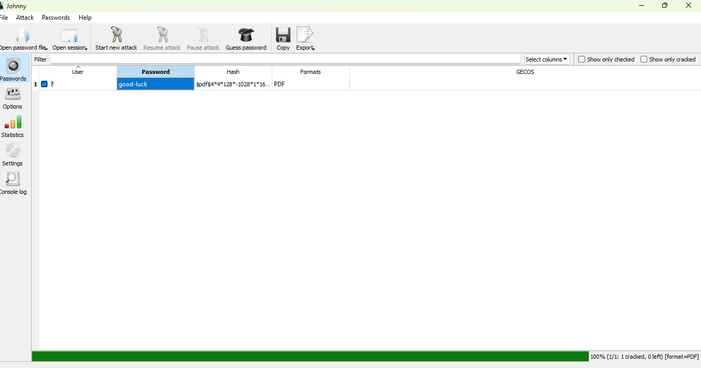
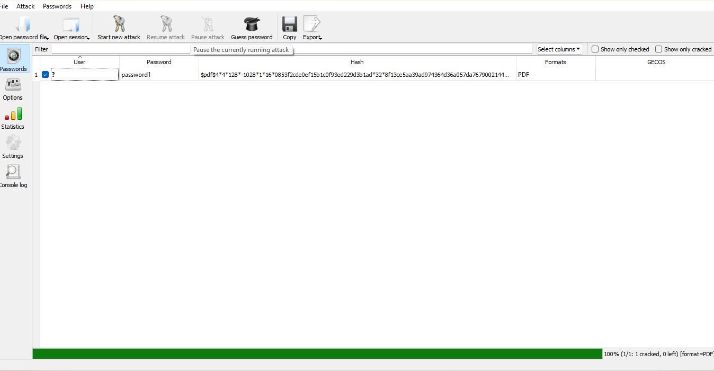
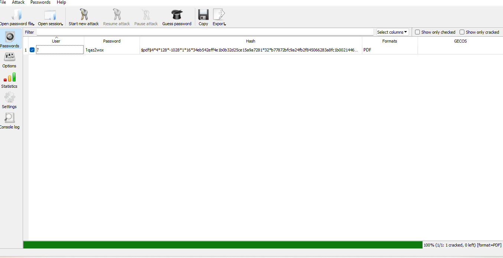
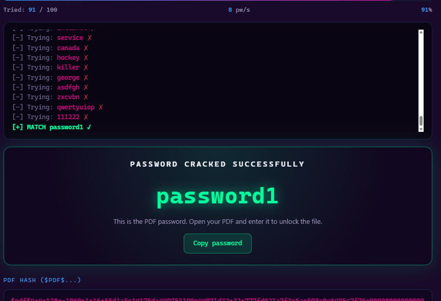
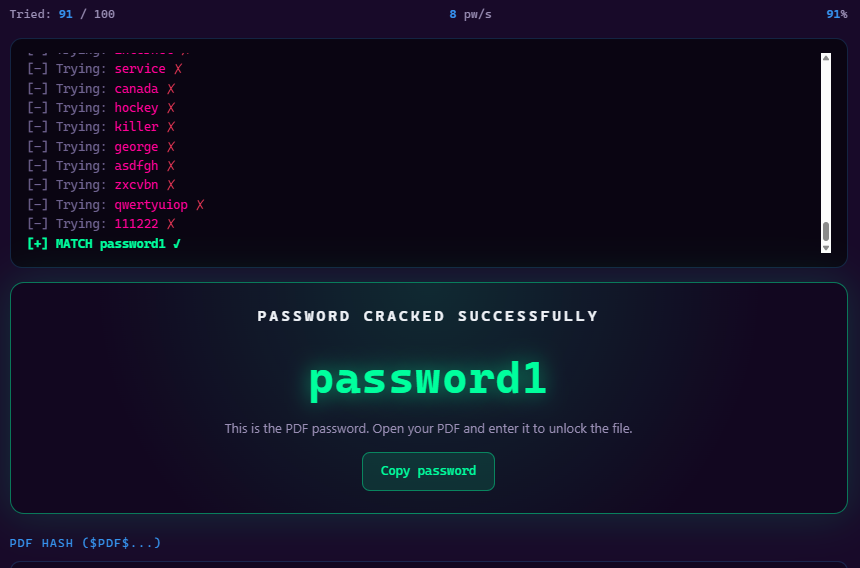

# Networkwalks-B084-Week3|  Password-Cracking-with-John-the-Ripper-JR-and-Networkwalks-Tools-

**W3-PM1 & W3-PM2  |  CYBERSECURITY  |  NETWORKWALKS**

##  Project Overview

The project uses John the ripper (JTR), Johnny, and NetworkWalks to extract hashes from locked PDFs and crack them, to show why weak passwords are risky and strong passwords are needed. 

# Tasks completed
WK3-PM1 : Password cracking with John the ripper (JTR) and johnny .

WK3-PM2 : Password cracking using networkwalks tools ( password hashing calculator & password cracker)

## Objectives

The main objectives of this project are to:

- Install John the ripper (JTR)
- Install johnny GUI
- To obtain hash value from encrypted PDF files using networkwalks hashing calculator
- To crack passwords using networkwalks password cracker

## Purpose of the Lab

The purpose of this lab is to demonstrate how encrypted documents store passwords as hashes, how hashes are calculated, and how password-cracking tools like john the ripper can recover weak passwords from those hashes, to show why strong passwords are important.

# Lab set up procedure

Step 1 - Install John the ripper (JTR) and john 

Both JTR and johnny GUI were downloaded from the offical website, and installed into a windows pc. Johnny GUI acted as the GUI front-end for the JTR.

Step 2- Use networkwalks tools

The encrypted PDF files were downloaded to windows PC, uploaded to the networkwalks Hashing Calculator to get their hash values, and those hashes were then loaded into the Networkwalks Password Cracker to recover passwords.

**Tool:** John the ripper(JTR), Johnny, networkwallks hash calculator and networkwalks password cracker & windows pc|

# Evidence collected

A total of 6 PDF files had to be cracked. 3 were cracked using John the Ripper(JTR), and the other 3 were cracked using Networkwalks Hashing Calculator and Password Cracker. Find the screen shorts below.

Using John the ripper

Password for Encrypted PDF file 1 

Password for Encrypted PDF file 2 

Password for Encrypted PDF file 3

Using Networkwalks Password Cracker

Password for Encrypted PDF file 1 

Password for Encrypted PDF file 2

# Observations

Every file has it's own unique hash, a long scrambled code that works like a fingerprint. It proves that the file has not been changed, and it can be used to find the password of an encrypted file. Documents with weak passwords are easy to crack, so using a strong password makes your document more secure.

